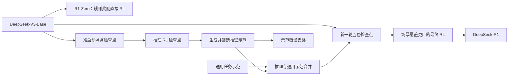

# L3 第 224 页｜拆解 DeepSeek-R1 技术报告

重点核对 R1 技术报告 §2.2、§2.3、§2.4。图中的箭头区分参数初始化和数据流。

R1-Zero 支路使用结果正确性和格式反馈，不经冷启动 SFT。R1 的冷启动监督提供结构清楚的回答作为起点；早期推理 RL 用可验证问题让策略探索。之后保留经过筛选的推理轨迹，与通用示范合并，对基座重新做监督训练。最终 RL 兼顾推理、通用 helpfulness 和 harmlessness。§2.4 描述的蒸馏使用由 R1 整理的数据监督小模型，图中的示范流表示进入这条分支的信号。模型文件、采样和雇人复核的成本要按支路分别计量。

**可验证决定。** 从同一推理检查点生成同样数量的候选，保持 token 预算与任务来源，将“只按结果核查后筛选”与“结果合格且过程受抽检后筛选”得到等量示范。训练同一初始学生，按独立题型测 pass@1、固定总 token 成功率和过程有效率。记录筛查成本。若过程筛选只提高过程判分而没有独立收益，且增加人工开销，该设置不升级。另留随机选取的合格示范基线以检验是否只因缩短输出。

本机 [小策略 SFT/GRPO 实验](results/tiny_posttrain.json) 只检验同输入反馈和资源口径，无法替代上述筛选对照。 [DeepSeek-R1 技术报告](https://arxiv.org/html/2501.12948v1)
